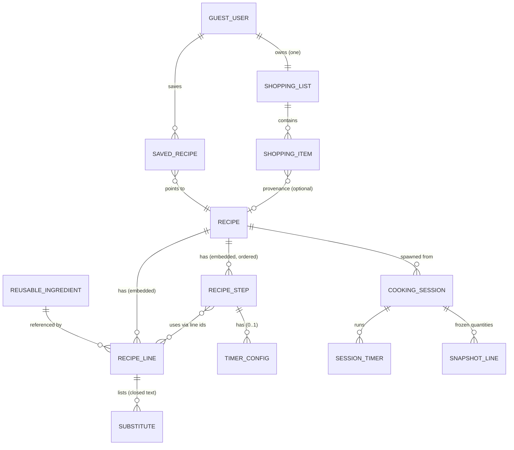

# Kooking — Data Model (Phase 4)

Status: **Implemented as domain layer + local persistence seam. No production database.**
Code: `shared/domain/` (zod schemas + pure rules), `shared/data/` (repository interfaces, memory + localStorage adapters). Tests: `shared/domain/*.test.ts` (65 passing).

## 1. Entities and relationships

| Entity               | File               | Key fields                                                                                                             |
| -------------------- | ------------------ | ---------------------------------------------------------------------------------------------------------------------- |
| Reusable ingredient  | `recipe-schema.ts` | id, name, category?, defaultUnit?, notes? — pantry-level catalog, no quantities                                        |
| Recipe line (usage)  | `recipe-schema.ts` | ingredientId ref, quantity?, unit?, preparation?, role, scaling, substitutes?, note?                                   |
| Recipe step          | `recipe-schema.ts` | order, instruction, ingredientIds (line refs), heat?, estimatedMinutes?, timer?, sensoryCue?, completionNote?          |
| Timer config         | `recipe-schema.ts` | durationSeconds (5–86400), label? — only where needed                                                                  |
| Recipe               | `recipe-schema.ts` | slug, title, categories (1–3), tags, baseServings, timeMinutes, lines, steps, contentVersion, status, demo, testedBy?  |
| Guest user           | `user.ts`          | id (device), kind: 'guest', createdAt — no credentials                                                                 |
| Saved recipe         | `user.ts`          | ownerId, recipeId, savedAt                                                                                             |
| Shopping list / item | `shopping.ts`      | one list per owner; items snapshot qty + servingsContext + optional recipe provenance                                  |
| Cooking session      | `session.ts`       | recipe ref + contentVersion, frozen servings, step index, completed ids, timers, quantity snapshot, status, timestamps |
| Session timer        | `session.ts`       | stepId, durationSeconds (copied verbatim), status, endsAt?, remainingSeconds                                           |

Reusable ingredients carry **identity** (what it is); recipe lines carry **usage** (how much, how prepared, what role, how it scales). Steps reference lines by id — never duplicate quantities in prose as source of truth.

## 2. Important constraints

- Step orders are contiguous from 1; step and line ids unique per recipe; step `ingredientIds` must resolve to recipe lines.
- `total === prep + cook` — derived, not decorated.
- Substitutes exist only on `substitutable` lines, as closed chef-approved text; `substitutable` lines require a non-empty list.
- To-taste lines have `quantity: null`; scaled lines require quantity **and** unit (a number without a unit can't be shopped or compared).
- Demo content (`demo: true`) can never be `published`.
- `tested/approved/published` require `testedBy` — the lifecycle, not marketing copy, backs any "tested" claim (`isChefTested()` gates UI wording).
- Amounts are finite, > 0, ≤ 1,000,000; units come from the closed `UNITS` vocabulary.
- One resumable session per recipe (latest non-completed); shopping re-adds aggregate only on identical recipe + servings.

## 3. Validation rules

Zod schemas at every boundary: content payloads (seed now, CMS later), storage rehydration (corrupt payloads fall back to empty, never crash), and repository inputs. Status transitions go through `STATUS_TRANSITIONS` (`draft → in_review → tested → approved → published`, with returns to `in_review`); session transitions through an explicit state machine (`active ↔ paused → completed|abandoned`, illegal moves throw). Recipe detail: `docs/RECIPE_CONTENT_MODEL.md`.

## 4. Quantity and scaling decisions

- Representation: `number | null` with `dedust()` (integer-shift float cleanup) before display rounding; no float dust reaches cooks (tested: 0.1×3 = 0.3 exactly).
- Behaviors: `linear` (exact), `discrete` (whole, min 1; also forced for `count` units), `approximate` (rounded + flagged "about"), `to-taste` (null, never scaled), `manual` (frozen + `requiresManual`).
- Rounding: metric ≥20 → nearest 5, 10–20 → whole, <10 → halves; kg/l → 2dp; household (cup/tbsp/tsp) → quarters with ¼½¾⅓⅔ glyphs; servings clamped 1–12 at the stepper.
- **No conversions, ever.** Same-unit comparison only; mismatched units fall back to the boolean `have` flag with `approximate: true`. Timers and instruction text are servings-invariant.

## 5. Persistence implications

Local-first per Phase 1: `localStorage` adapters revalidate on every read and cap session history (last 20); `Memory*` adapters serve tests. Repository interfaces (`RecipeRepository`, `SavedRepository`, `ShoppingRepository`, `SessionRepository`) are the only seam features may use — Supabase later plugs in behind them. IndexedDB deferred until history outgrows localStorage comfort. No auth, no remote DB in this phase.

## 6. Unresolved domain questions

1. Household-measure conversions (cup/derica/mudu ↔ grams) need chef-validated tables before any conversion feature — currently refused by design.
2. Per-dish rounding preferences (e.g. rice in whole cups vs. grams) await the chef partner.
3. Ingredient catalog registry + cross-check of line `ingredientId`s at CMS validation time (schema allows any id today).
4. Multi-list support, shared/household lists, and cloud-sync conflict policy — all post-MVP.
5. Whether `estimatedMinutes` needs chef-calibrated ranges vs. free guidance.
