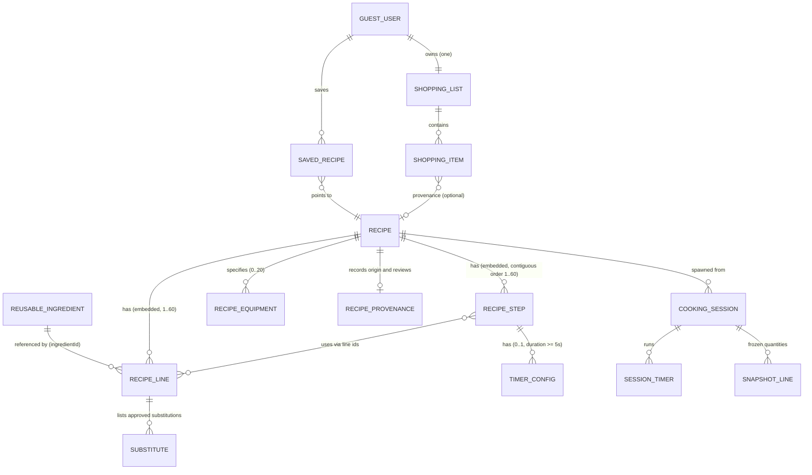

# Fork — Data Model (Phase 12: Structured Recipe Data)

Status: **Implemented and fully validated as structured domain models. No production database.**
Code: `shared/domain/` (Zod schemas, pure domain rules, validation helpers), `shared/data/` (repository interfaces, memory + localStorage adapters). Tests: `shared/domain/*.test.ts` (170 tests passing).

## 1. Entities and Relationships

| Entity               | File               | Key Fields                                                                                                                                                                                                                                           |
| -------------------- | ------------------ | ---------------------------------------------------------------------------------------------------------------------------------------------------------------------------------------------------------------------------------------------------- |
| Reusable ingredient  | `recipe-schema.ts` | `id`, `name`, `category?`, `defaultUnit?`, `notes?`, `aliases` — pantry-level catalog, no quantities                                                                                                                                                 |
| Recipe line (usage)  | `recipe-schema.ts` | `id`, `ingredientId` ref, `quantity?`, `unit?`, `preparation?`, `role`, `scaling`, `substitutes?`, `note?`, `constraint?`                                                                                                                            |
| Recipe step          | `recipe-schema.ts` | `id`, `order` (1..n contiguous), `instruction`, `ingredientIds`, `ingredientQuantities?`, `heat?`, `estimatedMinutes?`, `timer?`, `sensoryCue?`, `completionNote?`                                                                                   |
| Timer config         | `recipe-schema.ts` | `durationSeconds` (5–86400), `label?` — only on steps where timing genuinely matters                                                                                                                                                                 |
| Recipe equipment     | `recipe-schema.ts` | `id`, `name`, `category?`, `notes?`, `optional` (default `false`)                                                                                                                                                                                    |
| Recipe provenance    | `recipe-schema.ts` | `source?`, `author?`, `reviewedBy?`, `reviewNotes?`, `license?`                                                                                                                                                                                      |
| Recipe               | `recipe-schema.ts` | `id`, `slug`, `title`, `description?`, `image?`, `categories` (1–3), `tags`, `baseServings`, `timeMinutes`, `equipment`, `ingredients`, `steps`, `notes`, `contentVersion`, `status`, `provenance?`, `demo`, `testedBy?`, `createdAt?`, `updatedAt?` |
| Guest user           | `user.ts`          | `id` (device UUID), `kind: 'guest'`, `createdAt` — no credentials                                                                                                                                                                                    |
| Saved recipe         | `user.ts`          | `ownerId`, `recipeId`, `savedAt`                                                                                                                                                                                                                     |
| Shopping list / item | `shopping.ts`      | one list per owner; items snapshot `quantity` + `servingsContext` + optional recipe provenance                                                                                                                                                       |
| Cooking session      | `session.ts`       | `recipeId` + `contentVersion`, frozen `servings`, `stepIndex`, completed ids, timers, quantity snapshot, status, timestamps                                                                                                                          |
| Session timer        | `session.ts`       | `stepId`, `durationSeconds` (copied verbatim), `status`, `endsAt?`, `remainingSeconds`                                                                                                                                                               |

Reusable ingredients carry **identity** (what it is); recipe lines carry **usage** (how much, how prepared, what role, how it scales, constraints). Steps reference lines by id — never duplicate quantities in prose as the source of truth.

---

## 2. Core Constraints & Invariants

- **Step Ordering**: Contiguous from 1 (`1, 2, 3, ...`). Duplicate or gapped orders fail validation.
- **Identifier Uniqueness**: Step `id`, ingredient line `id`, and equipment `id` must each be unique within the recipe.
- **Reference Integrity**: Every step `ingredientIds` and `ingredientQuantities` key must resolve to an ingredient line `id` within the recipe.
- **Catalog Cross-Referencing**: Every `ingredientId` and catalog-formatted substitute must resolve against the reusable ingredient catalog (`validateRecipeAgainstCatalog`).
- **Substitution Integrity**: Substitutes only exist on `substitutable` lines; `substitutable` lines require ≥1 chef-approved substitute; a line can never list itself as a substitute.
- **Time Invariant**: `total === prep + cook` — derived, never decorated or estimated independently.
- **Scaling & Unit Invariants**: To-taste lines require `quantity: null` and `unit: null`. Scaled lines (linear, discrete, approximate) require finite positive quantity and valid unit.
- **Timestamps**: `createdAt` and `updatedAt` are ISO 8601 strings. When both exist, `updatedAt >= createdAt`.
- **Honesty & Lifecycle**:
  - `demo: true` recipes **cannot** be marked `tested`, `approved`, or `published`.
  - `tested`, `approved`, and `published` require verifiable culinary tester attribution (`testedBy`).
  - `published` recipes require an immutable `createdAt` timestamp.
  - UI claims of testing are gated strictly by `isChefTested(status)`.

---

## 3. Validation Rules

Zod schemas enforce validation at every runtime boundary:

- Schema parsing: `recipeSchema.parse(raw)` fails closed.
- Human-friendly validation: `validateRecipe(raw)` formats issues into clear error messages.
- Catalog validation: `validateRecipeAgainstCatalog(recipe, catalog)` catches orphan ingredient IDs or broken substitution references.
- Status state machine: `STATUS_TRANSITIONS` enforces valid editorial workflow (`draft → in_review → tested → approved → published`, with returns to `in_review`).

---

## 4. Content Independence

The domain recipe data model is presentation-agnostic and acts as the single source of truth across:

1. **Recipe Detail Pages**: Overview, time badges, equipment, prep list, and tips derived from structured fields.
2. **Kitchen Check**: Verification of required vs. optional ingredients before cooking begins.
3. **Servings Scaler**: Computes clean proportional scaling for linear/discrete/approximate ingredients.
4. **Cooking Mode**: Active step walkthrough with countdown timers, heat level warnings, and sensory cues.
5. **Shopping List**: Derives items from ingredient lines, skipping `to-taste` entries.
6. **Voice / Assistant APIs**: Structured steps and cues ready for voice synthesis without scraping markup.

---

## 5. Persistence Seam

Local-first persistence per Phase 1 architecture:

- `localStorage` adapters revalidate against schemas on every read.
- In-memory adapters (`MemoryRecipes`, `MemoryIngredients`) provide deterministic testing.
- Repository interfaces (`RecipeRepository`, `IngredientRepository`, `SavedRepository`, `ShoppingRepository`, `SessionRepository`) isolate storage from features.
- No production database introduced; ready for future CMS / Supabase adapter injection behind the existing repositories.
