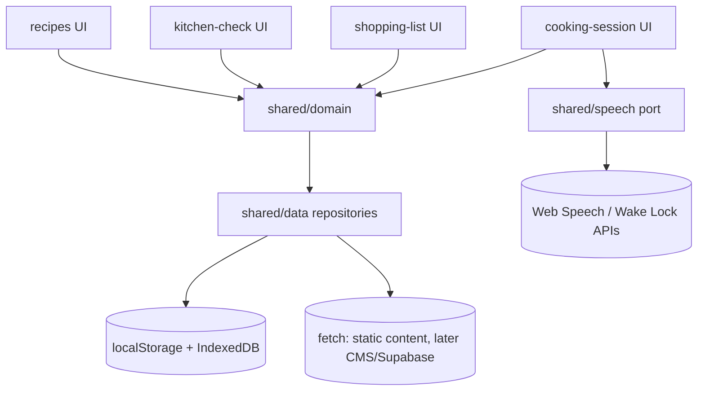

# Fork — Product Architecture (Phase 1)

Status: **Proposed — for review. No implementation.**
Scope: MVP only (capabilities 1–21 in Phase 1 brief). No home/recipe UI built in this phase. No CMS, auth backend, or AI systems.

Phase 0 finding: repository and remote (`Prince-uxdesign/Fork`) are both empty with no commits and no established stack. This is a greenfield architecture. Nothing to migrate or retain.

## 1. Product vision and core journey

Fork is a mobile-first cooking companion. The central experience is cooking, not browsing.

Core journey:

```
DISCOVER → CHECK → SHOP → COOK → COMPLETE
```

Architecture implication: all five stages must operate on **one structured recipe model**. No stage gets its own forked copy of recipe data. Discovery, Kitchen Check, shopping lists, and Cooking Mode are views and derivations over the same source.

## 2. Application modules and responsibilities

Six feature modules plus a shell. Each owns its UI, state, and derivations — but business rules live in pure domain functions, not components.

| Module            | Owns                                                                                                                                       | Does not own                                                                                          |
| ----------------- | ------------------------------------------------------------------------------------------------------------------------------------------ | ----------------------------------------------------------------------------------------------------- |
| `recipes`         | Recipe discovery, search/filter, detail reading, servings selection, saved flag display. Recipe schema, scaling math, quantity formatting. | Kitchen inventory, shopping persistence, session progress.                                            |
| `kitchen-check`   | Pantry/inventory input for one recipe + servings context, readiness evaluation, missing-list derivation.                                   | Shopping list storage, cooking timers. Consumes `recipes` domain, produces input for `shopping-list`. |
| `shopping-list`   | Personal items + recipe-derived items, checked state, aggregation across recipes.                                                          | Recipe content itself. Stores only references + snapshotted quantities.                               |
| `cooking-session` | Step-by-step mode, contextual quantities, timers, progress, pause/resume, persistence, completion, read-aloud dispatch.                    | Recipe editing, shopping. Consumes `recipes` domain read-only.                                        |
| `saved`           | Save/unsave, saved collection view. Thin layer over recipe IDs.                                                                            | Recipe content, search ranking.                                                                       |
| `shell` / `pwa`   | App layout, navigation, install prompt, offline fallback UI, wake-lock coordination, global error boundary, toast.                         | Any recipe business logic.                                                                            |

Shared (not features):

- `shared/ui`: presentational primitives only (buttons, sheets, steppers, timer display, quantity text). No business rules, no fetching.
- `shared/domain`: pure TypeScript functions — scaling, kitchen-check evaluation, list derivation, session transitions, formatting. No React, no storage, no network.
- `shared/data`: repository interfaces + local adapters (read recipes, persist sessions/lists/saves). Only layer allowed to touch `localStorage` / IndexedDB / `fetch`.
- `shared/speech`: `SpeechPort` interface (`speak`, `stop`, `listen`, capability probes). Adapters for Web Speech APIs. No UI imports.



## 3. Layer boundaries

Strict direction: **UI → feature logic → domain → data → storage/network**. Never reverse. External services are only touched through ports.

```
app/ routes (thin, params + layout)
  └─ features/<name>/ components + hooks (interaction state)
       └─ shared/domain (pure rules, unit-testable)
            └─ shared/data (repositories, validation, persistence)
                 └─ storage: localStorage / IndexedDB / fetch
                 └─ services: SpeechPort, WakeLockPort (adapters only)
```

Rules:

1. **UI components** render and capture input. No quantity math, no readiness logic, no timer arithmetic inside components.
2. **Feature modules** orchestrate one user task (e.g. `useKitchenCheck`, `useCookingSession`). They call domain functions and repositories; they do not implement rules inline.
3. **Business logic** (`shared/domain`) is pure: same input → same output, no dates, no random, no I/O. Fully unit-testable without React.
4. **Data access** (`shared/data`) validates at the boundary (schema parse), maps storage shapes to domain shapes, and exposes `Result`-style errors. Components never call storage APIs directly.
5. **Persistent storage** is local-first in MVP. No direct Supabase calls from components, even after Supabase is added — it goes behind the same repository interfaces.
6. **External services** (speech synthesis/recognition, wake lock) sit behind capability-probed ports. If unsupported, features degrade, never crash.

## 4. One recipe model reused everywhere

Single canonical `Recipe` shape (TypeScript + schema-validated JSON). All modules derive from it; none duplicate it.

```ts
type IngredientRole = "required" | "optional" | "substitutable" | "garnish";

interface IngredientLine {
  id: string;
  name: string;
  quantity: number | null; // null = "to taste", not scalable
  unit: string | null; // g, ml, cup, tbsp, piece, pinch...
  role: IngredientRole;
  group?: string; // e.g. "stew base", "for serving"
  scalable: boolean; // false for "to taste", garnish-as-preferred
  substitutes?: string[]; // fixed chef-approved list, NOT AI-generated
  note?: string;
}

interface InstructionStep {
  id: string;
  index: number;
  title: string;
  body: string; // chef-validated, fixed
  ingredientRefs?: string[]; // IngredientLine ids used in this step
  timerSeconds?: number | null; // fixed duration, servings-invariant
  servesNote?: string | null; // only if instruction genuinely changes
}

interface Recipe {
  id: string;
  slug: string;
  title: string;
  description: string;
  image?: string;
  tags: string[];
  baseServings: number;
  timeMinutes: { prep: number; cook: number; total: number };
  ingredients: IngredientLine[];
  steps: InstructionStep[];
  contentVersion: number; // for future CMS invalidation
}
```

Derivation map:

| Consumer                  | Input                                      | Derivation                                        |
| ------------------------- | ------------------------------------------ | ------------------------------------------------- |
| Detail + servings stepper | `Recipe` + `targetServings`                | `scaleIngredients()` — pure                       |
| Cook step N               | `Step.ingredientRefs` + scaled ingredients | `contextualQuantities()` — pure                   |
| Kitchen Check             | scaled ingredients + pantry input          | `evaluateReadiness()` — pure                      |
| Shopping list             | missing items from check, or whole recipe  | `toShoppingItems()` — snapshot + refs             |
| Timers                    | `Step.timerSeconds`                        | session timer entities, durations copied verbatim |

Content rule (MVP): recipe bodies and substitution lists are **fixed chef-validated data**. No AI generation, no unrestricted substitution. The schema enforces this by making `substitutes` a closed string list, not a free-text prompt.

## 5. Cooking-session state and persistence

Session is a first-class persisted entity, separate from the recipe. Recipe is immutable input; session is mutable progress.

```ts
interface SessionTimer {
  id: string;
  stepId: string;
  durationSeconds: number;
  status: "idle" | "running" | "paused" | "done";
  endsAt: number | null; // epoch ms when running
  remainingSeconds: number; // authoritative when paused/idle
}

interface CookingSession {
  id: string; // nanoid/uuid, route param
  recipeId: string;
  recipeSlug: string;
  contentVersion: number; // detect stale sessions if recipe updates
  servings: number; // frozen at session start, change = new session or rescale
  currentStepIndex: number;
  completedStepIds: string[];
  timers: SessionTimer[];
  status: "active" | "paused" | "completed" | "abandoned";
  createdAt: number;
  updatedAt: number;
}
```

State machine: `active ↔ paused → completed | abandoned`. Only one **resumable** session per recipe (latest non-completed); history beyond that is out of MVP.

Persistence:

- Store sessions in IndexedDB (key `sessions:<id>`), with a lightweight `localStorage` pointer `kooking:last-session:<recipeId>` for resume banners. IndexedDB because session + timers must survive reload and exceed `localStorage` comfort.
- Write-through on every transition (step advance, timer start/pause, servings lock). Debounce not needed — payloads are small.
- Timer representation is reload-safe: when running, `endsAt` is set; on load, `remaining = max(0, endsAt - now)`. No `setInterval` drift is persisted; intervals are UI-only ticks.
- On recipe `contentVersion` mismatch at resume, show non-blocking notice and continue with snapshot quantities (sessions snapshot scaled quantities at start so cooking never shifts mid-cook).
- TTS/speech state is never persisted — it is ephemeral and re-attached on resume.

## 6. Servings: scaling rules

`factor = targetServings / baseServings`. Scaling is linear and display-only until a session or check freezes it.

- Apply only where `scalable === true` and `quantity !== null`. `quantity: null` ("to taste", "as needed") never scales.
- Rounding by unit class: `g/ml ≥ 10` → nearest 5 or 10; `cup/tbsp/tsp` → nearest common fraction (¼, ⅓, ½); `piece/egg/onion` → nearest whole with minimum 1; spices/pinch → 1 decimal max. Formatting (`formatQuantity`) is the only place fractions are rendered.
- Timers and step bodies **do not scale**. `timerSeconds` is invariant. If a step genuinely depends on servings (e.g. "cook in batches"), that must be explicit `servesNote` content from the chef, never computed.
- Kitchen Check and shopping snapshots record both `baseQuantity` and `scaledQuantity` + `servings` so later servings changes create new derivations rather than mutating history.
- Servings range clamped (e.g. 1–12). Stepper is the single UI control; domain exposes `clampServings()`.

## 7. Kitchen Check evaluation

Pure function: `(scaledIngredients, pantryInput) → ReadinessReport`. No storage, no UI.

```ts
interface PantryInput {
  ingredientId: string;
  have: boolean;
  haveQty?: number | null;
}
type ItemStatus = "have" | "need" | "substitute-ok" | "optional-missing";
interface ReadinessReport {
  ready: boolean;
  items: { ingredientId: string; status: ItemStatus; needQty: number | null }[];
  missingRequired: string[]; // blocks "ready to cook"
  missingOptional: string[]; // never blocks
}
```

Rules:

- `required`: `haveQty >= scaledQty` (or `have === true` when qty unknown) → `have`, else `need`. Any `need` in required → `ready: false`.
- `substitutable`: `need` is satisfiable by checking a listed substitute as `have` → `substitute-ok`, does not block. Free-text substitutes are not accepted in MVP.
- `optional` / `garnish`: missing never blocks. Reported separately as `optional-missing` for display only.
- Quantity comparison is unit-aware only for identical units in MVP. Cross-unit conversion (cup ↔ g) is explicitly out of MVP — if units differ, fall back to boolean `have` check and flag `needQty` as approximate.
- Output feeds two actions: (a) CTA enablement ("Start cooking" requires `ready`, "Add missing to shopping list" always available), (b) shopping-list derivation of `missingRequired + selected optional`.

## 8. Shopping lists: recipe-linked + personal

One list store, two item origins. Users never manage two separate list systems.

```ts
interface ShoppingItem {
  id: string;
  origin: "recipe" | "personal";
  recipeId?: string;
  recipeSlug?: string;
  ingredientId?: string; // set when origin === 'recipe'
  name: string;
  unit: string | null;
  qty: number | null; // scaled snapshot at time of adding
  servingsContext?: number; // servings the qty was computed for
  checked: boolean;
  createdAt: number;
}
```

Rules:

- Adding from Kitchen Check or recipe detail creates `origin: 'recipe'` items with full provenance. Re-adding the same `ingredientId` from the same recipe + servings aggregates quantity rather than duplicating; different servings create a separate line with visible context ("for 4 servings") to avoid silent merging errors.
- Personal items (`origin: 'personal'`, free name/qty) are fully CRUD and never require a recipe.
- Checking off is local-only state. Deleting a recipe does not delete personal items. Clearing "recipe items for X" is an explicit bulk action.
- Quantities are snapshots. If servings change after adding, the list does not auto-mutate — user re-adds or edits. This avoids mid-shop surprises.

## 9. Unauthenticated use (default path)

No login wall. Ever, in MVP. Guest is the primary user, not an edge case.

- On first run, generate a local `deviceId` (persisted). All saves, lists, sessions, and pantry inputs are keyed to it locally.
- Full core journey works without an account: discover, check, shop, cook, complete, save.
- "Optional accounts" means: later, a Supabase user can **attach** to existing local data and sync it. Migration is upload-and-merge by ID, never wipe-and-replace. Until then, no auth UI beyond a dormant placeholder route (or nothing at all — preferred).
- No remote fetching of personal data in MVP. Recipe content may be fetched remotely (static hosting) but personal state never leaves the device.

## 10. Local vs. future remote data

| Data                            | MVP (local)                                                 | Later (remote, when justified)                      |
| ------------------------------- | ----------------------------------------------------------- | --------------------------------------------------- |
| Recipe content (chef-validated) | Bundled static JSON + runtime `fetch` cache                 | CMS → versioned API, same schema + `contentVersion` |
| Saved recipe IDs                | `localStorage`                                              | Supabase `saves` table, merge by ID                 |
| Shopping items                  | IndexedDB/localStorage                                      | Supabase `shopping_items`, same shape + `user_id`   |
| Cooking sessions (active)       | IndexedDB, device-only                                      | Sync of completed summaries only, not live timers   |
| Pantry/check inputs             | Ephemeral + session-scoped, optionally persisted per recipe | Not synced in MVP; later per-user preference        |
| User account                    | None                                                        | Supabase Auth, attached lazily                      |

Principle: local is the source of truth in MVP. Remote, when added, is a sync target behind the same repository interfaces — not a rewrite.

## 11. Offline matrix

PWA with app-shell + content caching. What works offline is a product promise, not a technical accident.

| Capability                                                                            | Offline | Notes                                                           |
| ------------------------------------------------------------------------------------- | ------- | --------------------------------------------------------------- |
| App shell, navigation, saved, lists, check, cook mode, timers, progress, pause/resume | ✅      | Fully local; service worker serves shell                        |
| Previously viewed recipes (cached)                                                    | ✅      | Runtime cache of JSON + images, versioned                       |
| Search/filter over cached set                                                         | ✅      | Client-side over cached index                                   |
| Search over full catalog uncached                                                     | ❌      | Requires network; show cached subset + notice                   |
| First-visit fetch of uncached recipe                                                  | ❌      | Show offline fallback, queue for retry                          |
| Read-aloud (system TTS)                                                               | ✅*     | Depends on device voices; no network needed for built-in voices |
| Voice input (recognition)                                                             | ⚠️      | Browser-dependent, often network-backed; degrade to touch       |
| Wake lock                                                                             | ✅*     | Where supported; silently degrade where not                     |
| Account sync / CMS updates                                                            | ❌      | Deferred; never blocks cooking                                  |

Service worker strategy: precache shell + home; runtime `StaleWhileRevalidate` for recipe JSON; `CacheFirst` for images with quota guard. Offline fallback route for uncached deep links.

## 12. Validation, errors, async

- **Validation**: schema-first at every external boundary (static JSON, future CMS, URL params, storage rehydration) using a schema library (Zod recommended). Invalid recipe content fails closed: card hidden + logged, never half-rendered. Storage rehydration failures fall back to empty state + one-time migration, never a crash loop.
- **Errors**: three tiers — (1) content errors (hidden card / fallback copy), (2) recoverable action errors (toast + retry: e.g. failed fetch, storage quota), (3) fatal (route error boundary + "back to home" + report hook). Cooking timers and step progress never depend on network promises.
- **Async**: `async/await` in repositories only. UI uses minimal loading states per route (skeleton on detail, never on cook steps — cook renders from local snapshot synchronously). No global store async middleware in MVP; no React Query until CMS search justifies it. Service worker updates surface as a non-blocking "Update available" toast, never an auto-reload mid-cook.

## 13. Future CMS workflow (accommodated, not built)

Recipe content flows one way: **chef → validated JSON → app**. The app never writes recipes.

```
chef draft → schema validation (CI) → versioned content (static/CMS)
  → app fetch + schema parse → cache by (id, contentVersion)
  → all modules render from validated Recipe
```

Accommodation points built now: `contentVersion` on recipes and sessions, repository interface with `getRecipe(id)` / `listRecipes()` that can swap static import for CMS fetch without touching features, image remote-domain allowlist placeholder, and a `content/` contract directory reserved for later (not created in MVP beyond schema types). No CMS SDK, no admin UI, no preview infra in MVP.

## 14. Voice interaction (future, decoupled)

Voice is a port, not a component. Cooking-session exposes a command API; any speech provider drives it.

```ts
interface SpeechPort {
  isSpeakSupported(): boolean;
  isListenSupported(): boolean;
  speak(text: string, opts?: { rate?: number }): void;
  stop(): void;
  listen(onCommand: (intent: CookIntent) => void): { stop(): void };
}
type CookIntent =
  | { type: "next" }
  | { type: "back" }
  | { type: "repeat" }
  | { type: "timer-start"; seconds: number }
  | { type: "timer-stop" }
  | { type: "mark-done"; stepId: string };
```

- MVP ships **read-aloud** (system speech synthesis of current step) via `SpeechPort.speak`. Limited voice commands (`next/back/repeat/timer`) are the only listening scope if added — free-form queries and AI substitutions are explicitly out.
- UI never imports `speechSynthesis` or `webkitSpeechRecognition` directly. A `useVoiceCommands(sessionController)` hook translates intents to the same functions touch buttons call. Swapping providers (browser → cloud → on-device) means swapping the adapter, not the cook UI.

## 15. Simplicity over architecture (what stays simple)

- **No global state library yet.** Route + `useState`/`useReducer` + repositories cover MVP. Add Zustand only if prop-drilling across cook/check/shop becomes painful — not preemptively.
- **No React Query / SWR yet.** Server Components + `fetch` cache + service worker cover MVP content. Add when CMS search/pagination demands it.
- **No Supabase/Auth/CMS SDKs yet.** Interfaces reserve the seam; dependencies wait for real need.
- **No unit conversion engine.** Same-unit compare + boolean fallback. A conversion table is a later content task with the chef, not a Phase 1 library.
- **No design-system package.** `shared/ui` primitives + one styling system (Tailwind recommended) in-repo.
- **No separate mobile/desktop apps.** One responsive PWA; adaptive layout via CSS, not forked routes.
- **No timer backend.** Timers are client-side durations. No push, no server cron, no background sync in MVP.
- **No analytics/tracking infra.** Defer; cooking must work with zero third-party scripts.

## 16. Proposed directory structure (when scaffolding begins)

Only for orientation — not to be created in this phase beyond `docs/`.

```
app/
  layout.tsx  page.tsx  manifest.ts
  recipes/[slug]/page.tsx
  recipes/[slug]/check/page.tsx
  cook/[sessionId]/page.tsx
  lists/page.tsx  saved/page.tsx  offline/page.tsx
components/            # thin route shells, composed from features + shared/ui
features/
  recipes/  kitchen-check/  shopping-list/  cooking-session/  saved/
shared/
  domain/    # pure rules: scaling, readiness, lists, session
  data/      # repositories, schemas, storage adapters
  ui/        # primitives
  speech/    # SpeechPort + adapters
  pwa/       # service worker, wake-lock hook
public/  content/seed/    # seed chef-validated JSON (later phases)
```

## 17. Risks

1. **Timer reliability when screen locked / tab backgrounded** — mitigate with `endsAt`-based math + wake lock where available; document that background throttling is expected and durations self-correct on visibility return.
2. **Speech/voice fragmentation** — capability-probe everything; touch parity for every voice command; never gate cooking on microphone permission.
3. **Offline cache staleness** — `contentVersion` + quota-guarded caches; stale recipe sessions continue from snapshot, never mid-cook mutation.
4. **Servings rounding confusion** — formatting rules must be chef-reviewed; show both scaled qty and servings context wherever quantities appear.
5. **Scope creep into CMS/auth/AI** — guarded by repository seams + explicit out-of-MVP list (see `TECHNICAL_DECISIONS.md`). Any PR adding Supabase/CMS/AI in MVP phases must justify against this doc.

---

Next: `INFORMATION_ARCHITECTURE.md` for routes/navigation, `TECHNICAL_DECISIONS.md` for final vs. provisional choices. Phase 2 must not begin until this doc is reviewed.
