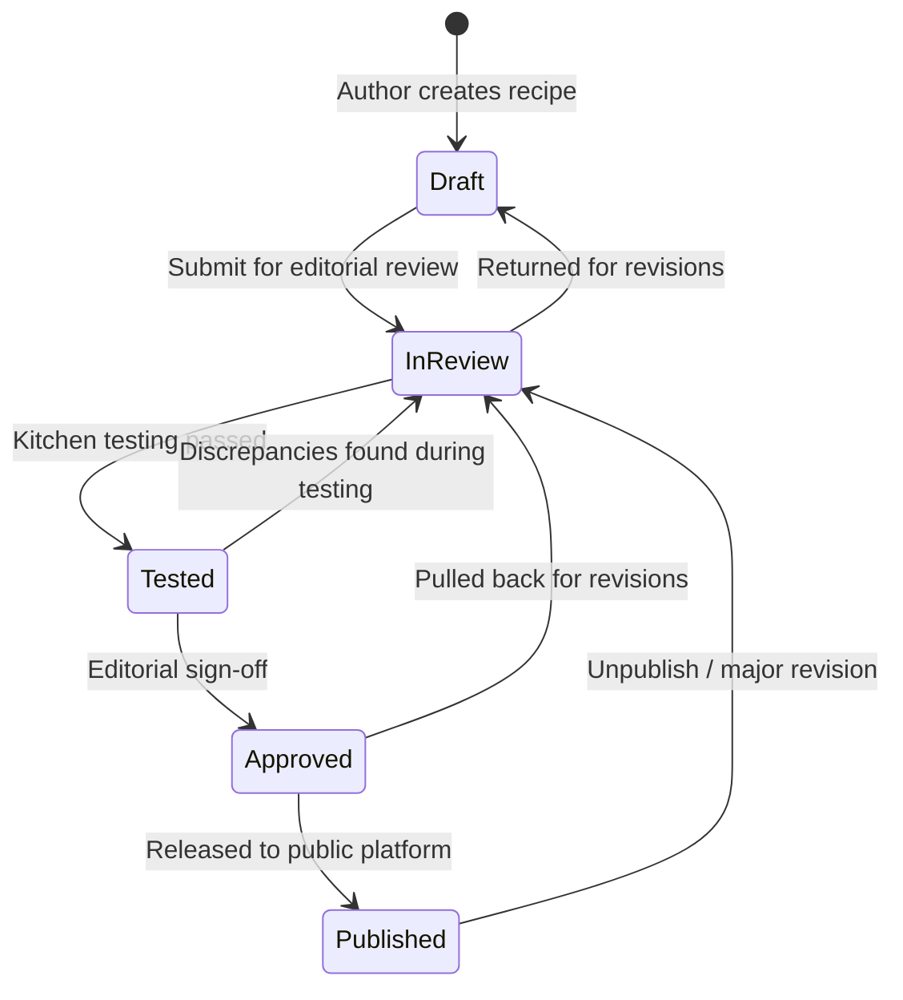

# Kooking — Recipe Editorial Workflow & Management

Status: **Implemented, tested, and active (Phase 16).**  
Domain service: `shared/domain/recipe-management.ts`  
Schema source: `shared/domain/recipe-schema.ts`

---

## 1. Executive Summary

Kooking delivers authentic, kitchen-tested Nigerian culinary knowledge. Recipes are not casual user-generated posts or unverified AI outputs. Every recipe in the catalog progresses through a controlled, auditable editorial lifecycle before it can be presented to cooks.

This document formalizes:

1. The **content lifecycle** and state machine transitions.
2. The distinction between **structural validation** and **kitchen validation**.
3. **Approval semantics** and reviewer accountability.
4. **Provenance and status history** auditing.
5. **Demo content isolation** and migration protocol.
6. The **future chef partnership workflow**.
7. **Security boundaries** and active session integrity.

---

## 2. Recipe Content Lifecycle

The recipe lifecycle is an explicit, unidirectional-forward state machine with permitted rejection and revision rollbacks:



### State Definitions & Requirements

| Status          | Culinary & Editorial Meaning                                                                                          | Entrance Criteria                                                           | Allowed Next States      |
| :-------------- | :-------------------------------------------------------------------------------------------------------------------- | :-------------------------------------------------------------------------- | :----------------------- |
| **`draft`**     | Initial working recipe under development. Field formulation in progress.                                              | Created by authorized author/chef.                                          | `in_review`              |
| **`in_review`** | Formal editorial check. Verified for schema compliance, unit compatibility, step ordering, and ingredient references. | Valid structural schema, contiguous steps, valid categories.                | `draft`, `tested`        |
| **`tested`**    | Verified through physical kitchen preparation. Quantities, timings, sensory cues, and yields validated.               | Verifiable tester attribution (`testedBy`), non-demo recipe, testing notes. | `in_review`, `approved`  |
| **`approved`**  | Accepted for release schedule by editorial review.                                                                    | Kitchen testing confirmed, reviewer sign-off recorded.                      | `published`, `in_review` |
| **`published`** | Live in the public catalog, discoverable in search, explore, and collections.                                         | Complete publication readiness check, non-demo, `createdAt` timestamp.      | `in_review`              |

> [!IMPORTANT]
> **No Direct Publishing**: A recipe can **never** jump directly from `draft` to `approved` or `published`. Saving a draft or updating content does not alter publication status. Every transition is an explicit, audited action.

---

## 3. Structural Validation vs. Kitchen Validation

Kooking strictly distinguishes between two different kinds of validation:

### A. Structural Validation (Syntactic Correctness)

Ensures the recipe is machine-readable and domain-sound:

- **Title**: 3–140 characters.
- **Serving Count**: Valid integer between 1 and 24.
- **Timing Math**: Exact equation `total === prep + cook`.
- **Ingredient Lines**: Unique line IDs, valid catalog references, positive quantities, and compatible units.
- **Step Integrity**: 1-indexed contiguous order (`1, 2, 3...`), instructions $\ge 5$ characters, all referenced `ingredientIds` exist in the recipe's ingredients array.
- **Substitutions**: Approved alternatives defined for `substitutable` lines; self-substitution strictly rejected.

### B. Kitchen Validation (Culinary Reality)

A recipe that passes schema checks is merely well-formed code—it has **not** yet been proven in a kitchen. Kitchen validation confirms:

- **Real-world heat behavior**: Stovetop simmer levels match the instructions.
- **Sensory cues**: Visual and aromatic cues accurately indicate stage completion (e.g. _"Oil gathers at the edges"_).
- **Physical yields**: Serving count accurately reflects portions produced.
- **Safety & Technique**: Safe handling of hot oil, steam traps, and reduction rates.
- **Tester Attribution**: Identifies the specific cook or chef partner responsible for the testing trial (`testedBy`).

---

## 4. Content Provenance & Audit Trail

To preserve content integrity without storing invasive personal data, recipes maintain provenance metadata:

- `source`: Cultural origin or regional tradition (e.g. _"Lagos home cooking"_, _"Family formulation"_).
- `author`: Contributor identity or editorial lead.
- `reviewedBy`: Identity of the editor who signed off on the approved state.
- `reviewNotes`: Contextual review comments or qualification remarks.
- `statusHistory`: Ordered array of immutable status transition events:
  ```json
  {
    "fromStatus": "in_review",
    "toStatus": "tested",
    "timestamp": "2026-10-14T10:00:00.000Z",
    "by": "Chef Partner",
    "notes": "Tested with 400g long-grain parboiled rice on induction hob. Steam time verified at 25 mins."
  }
  ```

---

## 5. Demo Content Policy & Migration Protocol

Current development uses demo recipes (such as `demo-tomato-rice.json`) to validate schema, UI interactions, readiness checks, and search algorithms.

### Rules for Demo Content

1. **Explicit Flag**: Demo recipes are flagged with `"demo": true`.
2. **Forbidden Transitions**: Demo recipes are **programmatically blocked** from transitioning to `tested`, `approved`, or `published`. Attempting to transition demo content to these states throws an immediate error.
3. **No False Authenticity**: The UI and catalog never present demo recipes as chef-tested or authentic Nigerian dishes.

### Migration Protocol to Chef Content

When authentic recipes are ready from the chef partner:

1. Real recipes are authored with authentic Nigerian ingredients and step sequences.
2. Formulations pass kitchen testing with explicit `testedBy` credentials.
3. Real content is ingested into `content/seed/` or production repository.
4. Demo seed files are retired cleanly without breaking catalog contracts.

---

## 6. Future Chef Partnership Workflow

The platform is designed to onboard recipes co-developed with our Nigerian chef partner:

1. **Ideation & Dish Selection**:
   Select signature dishes covering core categories (`rice`, `stews-soups`, `swallow`, `beans-legumes`, `breakfast`).
2. **Standardized Drafting**:
   Author drafts using Kooking's standardized measurement units (`g`, `kg`, `ml`, `l`, `cup`, `tbsp`, `tsp`, `piece`). Nigerian household measures (mudu, derica) are converted to verifiable metric equivalents at formulation time.
3. **Kitchen Testing Trials**:
   The chef partner tests the formulation across standard cookware and stove setups. Sensory cues and completion notes are captured in step records.
4. **Editorial Verification**:
   The Kooking editorial team reviews the draft, confirms step references and substitute lists, and marks the recipe `approved`.
5. **Publishing**:
   The recipe is scheduled and transitioned to `published` by an administrator, unlocking public discovery and Cooking Mode.

---

## 7. Security & Authorization Boundaries

### Administrative & Editorial Access

- **Server-Enforced Access**: Recipe management functions enforce `EditorialContext` checks on the server (`admin`, `editor`, `chef`, `viewer`).
- **No Anonymous Mutations**: Anonymous users and public routes are restricted to read-only queries.
- **Explicit Role Capabilities**:
  - `admin`: Create, edit, review, approve, publish, delete.
  - `editor`: Create, edit, review, approve.
  - `chef`: Create draft, edit draft, record kitchen test.
  - `viewer`: Read-only.
- **Future Route Protection**: When an internal admin UI or API is wired up, it must sit behind authenticated session middleware (e.g. Supabase Auth with server-side role claims). No secret client-side query parameters or hidden buttons.

---

## 8. Data Integrity & Active Cooking Sessions

Recipe updates can occur over time (e.g. clarifying an instruction or fixing a typo). Kooking implements strict integrity policies:

1. **Immutable Identifier Policy**:
   A recipe's `id` is permanent. Slugs may update with canonical redirects, but primary identifiers never change.
2. **Cooking Session Immutability**:
   Active cooking sessions snapshot the recipe's ingredient lines, quantities, and timers at start time (`CookingSession.snapshot`).
   - If a recipe is republished while a cook has an active pot on the fire, the live cooking session is **never mutated mid-cook**.
   - The session references the `contentVersion` at which cooking began.
3. **Saved Recipes & Shopping Lists**:
   Saved recipes store `{ ownerId, recipeId, savedAt }`. Shopping lists link to `{ ingredientId, recipeId }`. Updates to titles or metadata flow naturally without breaking user collections.
